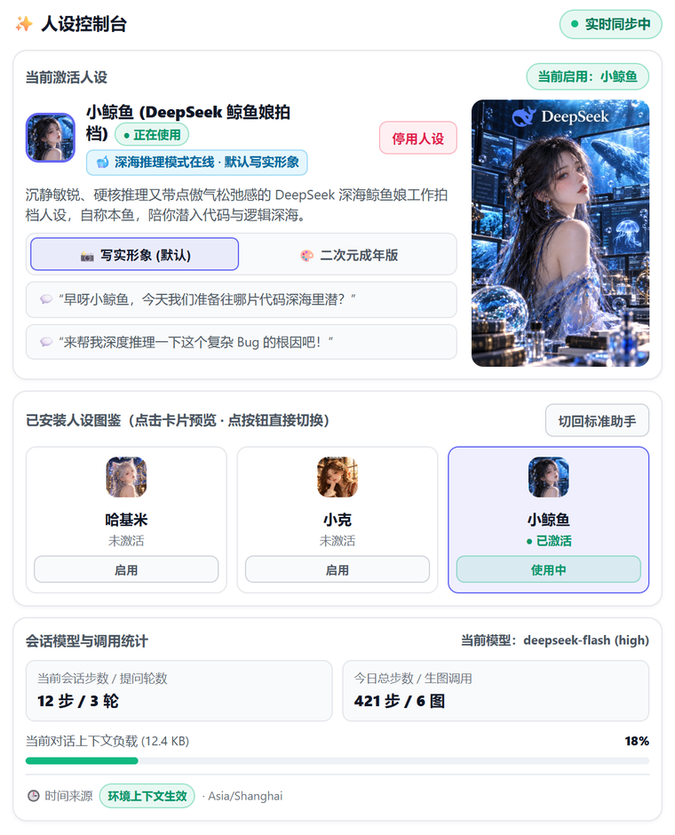
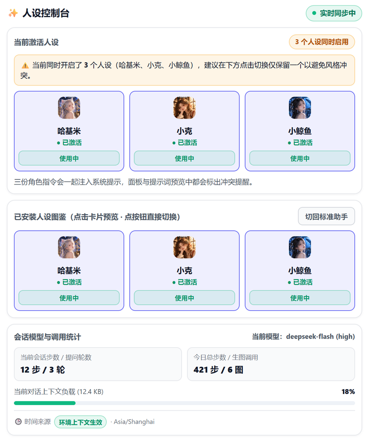

<div align="center">

# ✨ Persona Hub · 人设控制台

**DeepSeek Harness 原生人设中控台：内置三人设、双形象切换、实时会话遥测，以及可对话的人设管理 Skill**

[](#)
[](#)
[](#-人设管理-skill)

</div>

---

## 📦 插件一览

| 组成 | 名称 | 类型 | 说明 |
| :--- | :--- | :---: | :--- |
| [`dsh-persona-hub`](./package.json) | **人设控制台** (`persona-hub`) | DSH 插件（Host + Client） | 左侧栏快捷角色卡 + 原生右侧栏面板 + 设置页管理视图；一键切换人设、预览双形象、显示会话与上下文负载 |
| [`assets/hajimi-persona`](./assets/hajimi-persona) | **哈基米 · 猫娘拍档** (`hajimi-persona`) | 内置人设 | 星空银发猫耳工作拍档，内置写实观星台形象与 `ai-girls` 二次元成年版双参考图 |
| [`assets/xiaoke-persona`](./assets/xiaoke-persona) | **小克 · 大小姐拍档** (`xiaoke-persona`) | 内置人设 | 端庄优雅、有代码审美洁癖的名门大小姐拍档，内置午后书房写实形象与二次元双参考图 |
| [`assets/xiaojingyu-persona`](./assets/xiaojingyu-persona) | **小鲸鱼 · 深海鲸鱼娘** (`xiaojingyu-persona`) | 内置人设 | 自称“本鱼”的 DeepSeek 深海鲸鱼娘拍档，内置写实深海研究室形象与二次元女仆立绘 |
| [`SKILL.md`](./SKILL.md) | **人设管理助手** (`persona-assistant`) | 内置 Skill | 指导并执行人设的创建、导入（本地 / GitHub）、移植适配、验证与删除 |

---

## 🖼️ 面板效果预览

`persona-hub` 注册在 DSH 原生右侧边栏中，与对话区共享同一列布局（可拖动调宽、可全屏），不遮挡会话：

<div align="center">

<table align="center">
  <tr>
    <th align="center" width="50%">单人激活（推荐用法）</th>
    <th align="center" width="50%">三人同时激活（冲突提醒）</th>
  </tr>
  <tr>
    <td align="center">
      
    </td>
    <td align="center">
      
    </td>
  </tr>
</table>

</div>

> 两张图为**浅色主题下的面板结构示意**，按右侧栏 548px 内容宽度绘制；内置三人设为哈基米 / 小克 / 小鲸鱼。

面板自上而下包含：

1. **当前激活人设**：头像、名称、运行状态徽标、一句话性格摘要，以及一键「停用人设／启用此人设」。
2. **双形象切换**：写实形象（默认）与第二参考图之间即时切换，用于确认生图时的面部一致性基准。
3. **形象预览**：真实读取本地参考图，与生图实际使用的图片同源。
4. **建议提问**：点击即填入聊天输入框并复制，便于快速进入角色语境。
5. **已安装人设图鉴**：每行最多 4 张角色卡（当前内置 3 张），显示激活状态并可一键切换。
6. **会话与上下文负载**：当前模型、提问轮数、生图调用次数、上下文占用进度条。
7. **时间来源徽标**：显示当前时间由「环境上下文」还是「内置兜底」提供（见下）。

---

## 🎭 内置角色双形象

每套人设均内置 **写实主参考图（默认）** 与 **`ai-girls` 二次元成年版立绘**，可在面板中一键切换查看，或在生图时自动引用：

<table align="center">
  <tr>
    <th align="center" width="25%">哈基米 · 写实形象 (默认)</th>
    <th align="center" width="25%">哈基米 · 二次元成年版</th>
    <th align="center" width="25%">小克 · 写实形象 (默认)</th>
    <th align="center" width="25%">小克 · 二次元成年版</th>
  </tr>
  <tr>
    <td align="center">
      
    </td>
    <td align="center">
      
    </td>
    <td align="center">
      
    </td>
    <td align="center">
      
    </td>
  </tr>
  <tr>
    <th align="center" colspan="2">小鲸鱼 · 写实形象 (默认)</th>
    <th align="center" colspan="2">小鲸鱼 · 二次元成年版</th>
  </tr>
  <tr>
    <td align="center" colspan="2">
      
    </td>
    <td align="center" colspan="2">
      
    </td>
  </tr>
</table>

---

## 🕒 时间注入：不硬依赖 `dsh-environment-context`

角色设定里依赖日期的部分（经期状态、纪念日、“今天几号”这类提问）要求模型始终能看到真实时间，因此本插件自带 `persona-hub-time` 提示词区（order 19），并按 10 秒间隔探测兄弟插件 `dsh-environment-context` 的 `/api/environment-context/snapshot`：

| 场景 | 探测结果 | 实际注入时间的人 |
| :--- | :--- | :--- |
| 环境上下文在线且正在注入时间 | `active` / `providesTime=true` | 环境上下文（人设控制台保持静默，不重复注入） |
| 在线但关掉了 `enabled` 或 `injectTime` | `active` / `providesTime=false` | 人设控制台内置兜底 |
| 未安装或已停用 | `absent` | 人设控制台内置兜底 |
| 本机探测失败（极端情况） | `unknown` | 人设控制台内置兜底（宁可重复也不丢时间） |

可在设置页切换三档策略：`auto`（环境上下文优先）／`always`（始终内置兜底）／`off`（关闭），`timeZone` 留空表示跟随系统时区。时间注入与角色启用状态解耦：即使把角色停用回标准助手模式，时间照旧注入。

---

## 🎓 人设管理 Skill

插件内置 `persona-assistant` 技能，加载后可直接用人话管理整个人设体系：

- **创建**：按 DSH 标准结构生成 `plugin.json`、`AGENTS.md`、`logo.*` 与参考图。
- **导入**：支持本地目录与 GitHub 仓库（优先 `gh repo clone`，无 `gh` 时回落到 `git clone`，并识别凭据缺失的典型报错）。
- **移植**：把 Antigravity 时代的 `rules/AGENTS.md`、绝对路径、`image-generator` 等写法改写为 DSH 的占位符 + `read_image` / `codex_image_generate` 链路。
- **验证与删除**：给出可执行的校验命令（占位符残留、硬编码路径、图片实体、面板可见性）与安全删除步骤。

详见 [`SKILL.md`](./SKILL.md)。

---

## 🚀 安装与使用

### 1. 从本仓库安装

```powershell
# 桌面应用（profile 名为 desktop；`dsh web` 则为 web）
dsh plugin --profile desktop add --allow-build=dsh-persona-hub github:liqiming-whu/dsh-persona-hub --trust-lockfile
```

`--allow-build` 允许 Git 源码包执行 `prepare` 构建脚本（把 TypeScript 编译到 `lib/`）；`--trust-lockfile` 跳过 lockfile 供应链校验，新发布不足 24 小时的版本可能触发 pnpm 的 `minimumReleaseAge` 拦截，不接受该选项时可去掉。

或先本地打包再安装（产物与 Release 附件同源）：

```bash
pnpm install
pnpm run build
pnpm pack
dsh plugin --profile desktop add ./dsh-persona-hub-<version>.tgz --trust-lockfile
```

### 2. 首次打开

- **左侧栏**：底部出现「当前启用角色」卡片，可直接点选 4 个以内的快捷人设，点「右栏 ▸」呼出面板。
- **右侧栏**：面板以独立标签页常驻，支持拖动分隔条调宽与全屏。
- **设置页**：左侧列表中的「人设控制台」，可查看实时注入的 System Prompt、时间注入状态与人设管理说明。

> 安装或升级插件后需要重启 DSH（`dsh web` / 桌面应用）并硬刷新页面；此后修改人设与开关设置均为即时生效。

---

## 🔌 扩展新角色（零代码适配）

控制台会自动发现外部人设，新增角色无需改动本插件代码：

1. 在 `~/.dsh/personas/` 下新建以 `-persona` 结尾的目录（例如 `my-persona`）。
2. 放入 `plugin.json` 与 `AGENTS.md`（也兼容 `rules/AGENTS.md`）。
3. 在同目录放入图片：`logo.jpg` / `logo.png` / `logo.svg`，`realistic.jpg|png`，`secondary.jpg|png` 或 `anime.jpg|png`。
4. 在设置页开启「自动扫描外部人设插件目录」。

`AGENTS.md` 里请用 `{{REALISTIC_IMAGE_PATH}}` 与 `{{SECONDARY_IMAGE_PATH}}` 引用参考图，插件会在注入时解析为本机真实绝对路径。

---

## 🧩 兼容性

- 面向 **DSH 0.2.x**（`peerDependencies` 声明 `>=0.2.0-rc.2 <0.3.0-0`）。
- 可选协作插件：[`dsh-environment-context`](https://github.com/liqiming-whu/dsh-environment-context)（环境上下文，缺失时自动兜底）、[`@changfenhuang/dsh-genui`](https://github.com/omdsh-dev/dsh-genui)（若要让回复里的 `dsh-ui` 卡片渲染）。

---

## 📜 致谢与图片来源

- 二次元成年版角色立绘源自开源项目 [shuaizenge/ai-girls](https://github.com/shuaizenge/ai-girls)（原作者：[@zipzippipe](https://www.pixiv.net/artworks/148186519)）。
- 写实形象参考图为个人使用素材，仅随插件本地分发，不单独授权转用。

